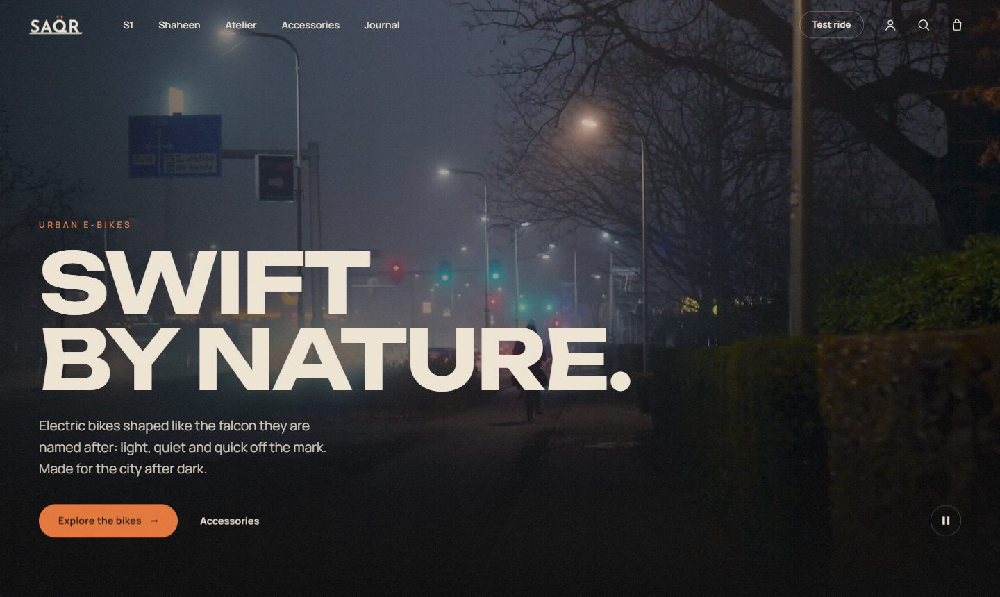

# Saqr

A custom Shopify Hydrogen storefront for **Saqr**, a fictional maker of premium electric bikes. Portfolio project: the brand, the products and the store are invented; the stack, the checkout and the customer account are real Shopify.

**Live demo: [saqr.argorr.workers.dev](https://saqr.argorr.workers.dev)** · **Case study: [claude.ai/artifact/KXUbVbG7K4MY2aoFzkc83J](https://claude.ai/artifact/KXUbVbG7K4MY2aoFzkc83J)**



## What it does

- **Product configurator**: finish, size and accessories on one page, with a size finder that suggests a frame size from your height.
- **Numbered limited edition**: the Shaheen is sold as serial-numbered bikes, each one a single unit with its number shown in the cart, the order and the account.
- **Expected delivery date**: the product page (computed on the server) and the cart show when a bike ordered today will be at home.
- **Build tracker**: bike orders show their build progress in the customer account, instead of a parcel tracking link.
- **Branded Shopify pages**: the Shopify-hosted checkout, sign-in and order pages use the Saqr colours, fonts and logo.
- **Free delivery on everything**: bikes are delivered and fitted at home, accessories ship free, under one delivery name at checkout.

## Stack

- [Hydrogen](https://shopify.dev/docs/storefronts/headless/hydrogen) 2026.4 with React Router 7 and React 18, TypeScript, Tailwind CSS 4
- Shopify Storefront API (catalogue, cart), Customer Account API (orders, addresses, profile), Admin GraphQL API for store setup
- Hosted on **Cloudflare Workers** (public demo) and **Oxygen** (Shopify's hosting) from the same build

## Performance

Mobile Lighthouse on the live homepage went from **73 to 80–89**, with a largest contentful paint measured by Chrome at about **1.2 s**. Main changes: stylesheets inlined in the server-rendered page, the hero video loaded after the first paint, and fonts preloaded.

## Run it locally

Requirements: Node.js 22 or 24, and a Shopify store with a Hydrogen storefront.

```bash
npm install
npx shopify hydrogen link   # connect to your own store
npx shopify hydrogen env pull
npm run dev
```

Other scripts: `npm run build`, `npm run typecheck`, `npm run lint`, `npm run deploy:cf` (Oxygen, then Cloudflare Workers).

## Project layout

- `app/routes`: pages (home, products, collections, cart, account, journal)
- `app/components`: UI, including `product/ProductConfigurator.tsx` and `account/BuildTracker.tsx`
- `app/lib`: brand data, sizes, delivery and build logic
- `design/case-study`: source of the case study page and its screenshots

---

Saqr is a fictional brand created for this portfolio. No real bikes are sold.
